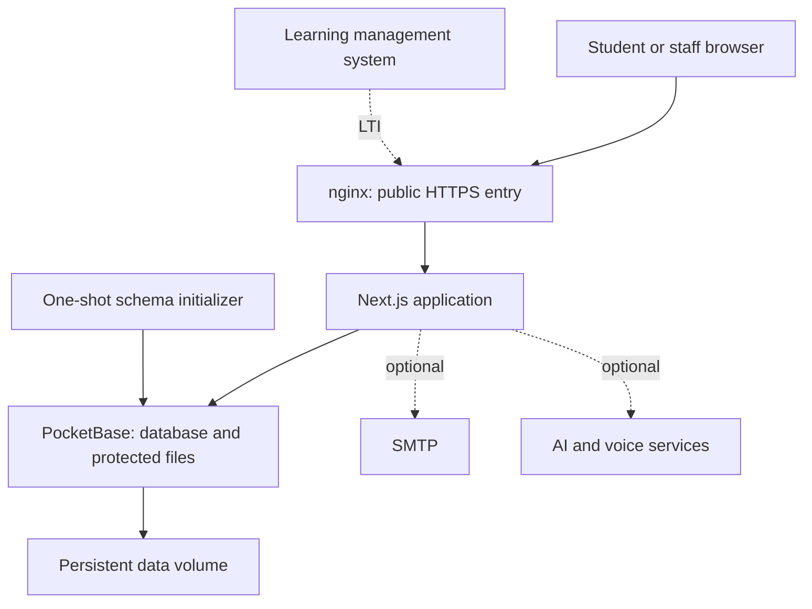

# Architecture and responsibilities

ClinicEdge runs a web application backed by a single PocketBase instance. Its database gateway centralizes access to content, identities, courses, and learning records. No external Supabase database or Clerk tenant is required.

## Service boundaries

| Service | Purpose | Operational rule |
| --- | --- | --- |
| `nginx` | Public entry, TLS/proxy policy, restricted database dashboard | Publish only ports 80/443 |
| `nextjs` | User interface, authorization, integrations | Keep its port private |
| `pocketbase` | SQLite records, hooks, migrations, protected uploads | One instance per data volume |
| `pocketbase-init` | Schema provisioning | Successful exit is expected |

Hooks and migrations are part of the runtime, not optional development files. Rebuilding only the web application is insufficient when they change.

## What administrators should edit

- **Application panel:** cases and review revisions; courses and assignments; questionnaires; learner credentials; supported settings and legal documents.
- **Deployment configuration:** public origin, service credentials, mail transport, optional AI/storage integration, TLS, and proxy rules.
- **Trusted operator tools:** full restore, controlled content import/export, offline identity handoff, and approved retention.

Do not make routine course changes directly in PocketBase. Doing so bypasses the publication workflow and can break historical snapshots. See [course administration](../course-administrators/index.md) for the supported path.

## Templates are not learner records

Reusable medical content can be exported independently. Patient attempts, conversations, classroom enrollments, consent evidence, seminar history, and uploaded private files are operational records. A portable content bundle is **not** a system backup.
